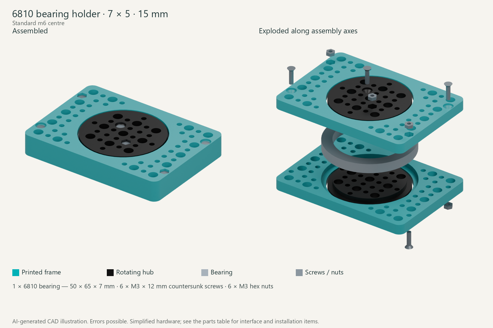

<!-- oobb-presentation:start -->
# OOBB bearing holders

AI-generated images and instructions. Errors possible.

## Summary

Parametric bearing holders with bearing-size, holder-style and mounting variants.

This is an entirely AI-generated coding project. The generated outputs are included and usually work, but the main purpose of publishing it is to give others a starting point for modifying the project with their own AI tools.

[7 × 5 6810 holder — 15 mm depth](parts/oobb_part_holder_bearing_6810_bearing_size_7_width_5_height_15_depth/)

## Details

This catalogue contains **44 records**. [Browse OOBB navigation](navigation_oobb/oobb/part/).

Each part has one canonical folder, its full OOMP ID and complete metadata. Navigation links open folders; use GitHub’s file pane to browse the available files.

[Build and maintenance guide](CATALOGUE_BUILD.md)

## Parts

The main example is the 7 × 5 6810 holder with 15 mm assembled depth. It uses two printed frame halves, two printed hub halves, one 6810 bearing, six M3 × 12 mm countersunk screws and six M3 nuts. Each holder page includes its own quantities and downloadable parts list.

## Assembly

Each holder page shows an assembled and exploded CAD diagram, with variant-specific steps and a necessary-parts table. Start with the 7 × 5 6810 example above, or choose another bearing and holder style in navigation.

[Project guide and existing assembly notes](PROJECT_GUIDE.md)
<!-- oobb-presentation:end -->
