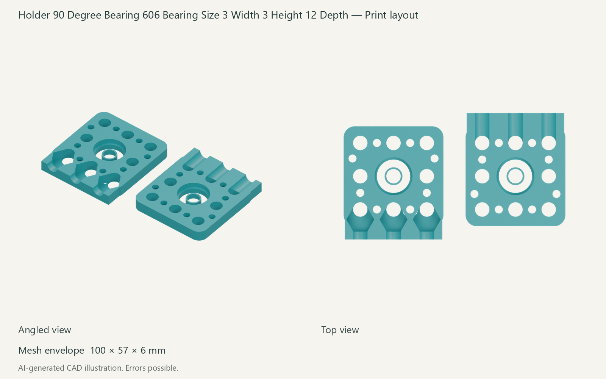

<!-- oobb-presentation:start -->
# OOBB bearing holders

AI-generated images and instructions. Errors possible.

## Summary

Parametric bearing holders with bearing-size, holder-style and mounting variants.

This is an entirely AI-generated coding project. The generated outputs are included and usually work, but the main purpose of publishing it is to give others a starting point for modifying the project with their own AI tools.

[Example part](parts/oobb_part_holder_90_degree_bearing_606_bearing_size_3_width_3_height_12_depth/)

## Details

This catalogue contains **44 records**. [Browse OOBB navigation](navigation_oobb/oobb/part/).

Each part has one canonical folder, its full OOMP ID and complete metadata. Navigation links open folders; use GitHub’s file pane to browse the available files.

[Build and maintenance guide](CATALOGUE_BUILD.md)

## Parts

Select the bearing size and holder style in navigation. Printed holder components and purchased bearings are distinct; the preview is generated from the printable mesh.

## Assembly

Follow the selected part’s split, preparation and embedded-nut metadata. Check bearing fit and retain the existing project examples for the applicable assembly.

[Project guide and existing assembly notes](PROJECT_GUIDE.md)
<!-- oobb-presentation:end -->
