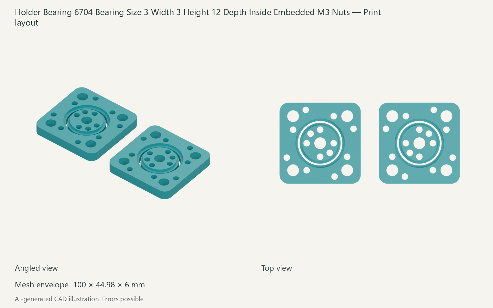
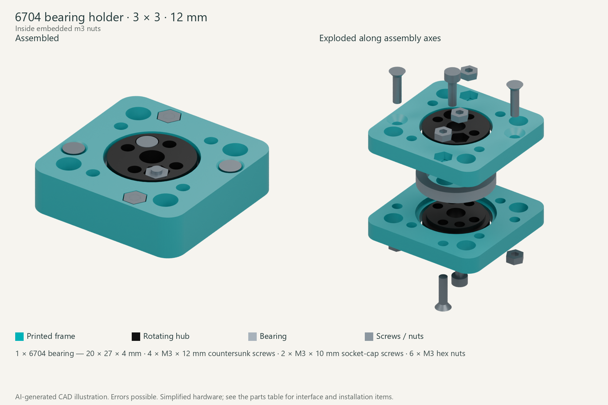

<!-- oobb-presentation:start -->
# Oobb Part Holder Bearing 6704 Bearing Size 3 Width 3 Height 12 Depth Inside Embedded M3 Nuts

AI-generated images and instructions. Errors possible.

## Summary

Parametric bearing holders with bearing-size, holder-style and mounting variants.

This is an entirely AI-generated coding project. The generated outputs are included and usually work, but the main purpose of publishing it is to give others a starting point for modifying the project with their own AI tools.



## Details

**Full OOMP ID:** `oobb_part_holder_bearing_6704_bearing_size_3_width_3_height_12_depth_inside_embedded_m3_nuts`

[Part folder](../../../../../../../../../../parts/oobb_part_holder_bearing_6704_bearing_size_3_width_3_height_12_depth_inside_embedded_m3_nuts/) · [OOBB navigation](../../../../../../../../../)

| Field | Value |
| --- | --- |
| Bearing Size | 6704 |
| Body | plate |
| Depth | 12 |
| Embedded Nut Rotation | 30 |
| Embedded Nut Rotation Radial | True |
| Extra | inside_embedded_m3_nuts |
| Height | 3 |
| Holder Type | holder |
| Horn Adapter |  |
| Inner Joining Head | socket_cap |
| Inner Joining Rotation | 45 |
| Inside | embedded_m3_nuts |
| Interior Radius Name | m3 |
| Mounting Minimum Web | 0.3 |
| Oobb Name | bearing_holder |
| Prepare Print | True |
| Print Gap | 10 |
| Shaft | m6 |
| Split | True |
| Split Z | 0 |
| Width | 3 |
| Taxonomy | oobb / part / holder / bearing / 6704_bearing_size / 3_width / 3_height / 12_depth / inside_embedded_m3_nuts |

<details>
<summary>Full part details: all working.yaml fields</summary>

```yaml
bearing_size: '6704'
bip_39_2_word_array:
- rhythm
- zebra
bip_39_2_word_no_space: rhythmzebra
bip_39_2_word_space: rhythm zebra
bip_39_2_word_underscore: rhythm_zebra
bip_39_3_word_array:
- rhythm
- zebra
- lunar
bip_39_3_word_no_space: rhythmzebralunar
bip_39_3_word_space: rhythm zebra lunar
bip_39_3_word_underscore: rhythm_zebra_lunar
bip_39_full_array:
- rhythm
- zebra
- lunar
- surprise
- hip
- share
- small
- cement
- 'false'
- rough
- want
- oval
bip_39_full_no_space: rhythmzebralunarsurprisehipsharesmallcementfalseroughwantoval
bip_39_full_space: rhythm zebra lunar surprise hip share small cement false rough
  want oval
bip_39_full_underscore: rhythm_zebra_lunar_surprise_hip_share_small_cement_false_rough_want_oval
depth: 12
design_note: Standard 15 mm hole spacing. M3 nut pockets do not fit the 6704 inner
  race at these positions; retain plain M3 holes instead.
directory: parts/oobb_part_holder_bearing_6704_bearing_size_3_width_3_height_12_depth_inside_embedded_m3_nuts
embedded_nut_positions: &id001
- - -7.5
  - 0
- - 7.5
  - 0
- - 0
  - -7.5
- - 0
  - 7.5
embedded_nut_rotation: 30
embedded_nut_rotation_radial: true
experimental: true
extra: inside_embedded_m3_nuts
height: 3
id: oobb_part_holder_bearing_6704_bearing_size_3_width_3_height_12_depth_inside_embedded_m3_nuts
id_no_class: oobb_part_holder_bearing_6704_bearing_size_3_width_3_height_12_depth_inside_embedded_m3_nuts
id_no_size: oobb_part_holder_bearing_6704_bearing_size_3_width_3_height_12_depth_inside_embedded_m3_nuts
id_no_type: oobb_part_holder_bearing_6704_bearing_size_3_width_3_height_12_depth_inside_embedded_m3_nuts
id_oobb: oobb_part_holder_bearing_6704_bearing_size_3_width_3_height_12_depth_inside_embedded_m3_nuts
inner_joining_head: socket_cap
inner_joining_rotation: 45
inside: embedded_m3_nuts
kwargs:
  bearing_size: '6704'
  body: plate
  depth: 12
  embedded_nut_positions:
  - - -7.5
    - 0
  - - 7.5
    - 0
  - - 0
    - -7.5
  - - 0
    - 7.5
  embedded_nut_rotation: 30
  embedded_nut_rotation_radial: true
  extra: inside_embedded_m3_nuts
  filter: ''
  generate_stl: false
  height: 3
  holder_type: holder
  horn_adapter: ''
  inner_joining_head: socket_cap
  inner_joining_rotation: 45
  inside: embedded_m3_nuts
  interior_hole_positions: []
  interior_radius_name: m3
  modes:
  - 3dpr
  - 'true'
  mounting_minimum_web: 0.3
  navigation: false
  oobb_name: bearing_holder
  oomp_description_extra: m6_shaft_inside_embedded_m3_nuts_extra_12_depth
  oomp_description_main: bearing_holder_3_width_3_height
  oomp_mode: project
  oomp_run: false
  overwrite: true
  prepare_print: true
  print_gap: 10
  shaft: m6
  split: true
  split_z: 0
  typ: fast
  type: default_bearing_holder
  width: 3
link_github: https://github.com/oomlout/oomlout_oomp_version_1_messy/tree/main/parts/oobb_part_holder_bearing_6704_bearing_size_3_width_3_height_12_depth_inside_embedded_m3_nuts
link_main: https://github.com/oomlout/oomlout_oomp_version_1_messy/tree/main/parts/oobb_part_holder_bearing_6704_bearing_size_3_width_3_height_12_depth_inside_embedded_m3_nuts
link_redirect: https://github.com/oomlout/oomlout_oomp_version_1_messy/tree/main/parts/oobb_part_holder_bearing_6704_bearing_size_3_width_3_height_12_depth_inside_embedded_m3_nuts
md5: b8dff2146d36bf8a73192952578bdbce
md5_10: b8dff2146d
md5_10_upper: B8DFF2146D
md5_5: b8dff
md5_5_upper: B8DFF
md5_6: b8dff2
md5_6_alpha: 77oqa
md5_6_alpha_upper: 77OQA
md5_6_upper: B8DFF2
name: Oobb Part Holder Bearing 6704 Bearing Size 3 Width 3 Height 12 Depth Inside
  Embedded M3 Nuts
name_no_class: Oobb Part Holder Bearing 6704 Bearing Size 3 Width 3 Height 12 Depth
  Inside Embedded M3 Nuts
name_no_size: Oobb Part Holder Bearing 6704 Bearing Size 3 Width 3 Height 12 Depth
  Inside Embedded M3 Nuts
name_no_type: Oobb Part Holder Bearing 6704 Bearing Size 3 Width 3 Height 12 Depth
  Inside Embedded M3 Nuts
name_proper: Oobb Part Holder Bearing 6704 Bearing Size 3 Width 3 Height 12 Depth
  Inside Embedded M3 Nuts
name_space: oobb part holder bearing 6704 bearing size 3 width 3 height 12 depth inside
  embedded m3 nuts
name_upper: OOBB PART HOLDER BEARING 6704 BEARING SIZE 3 WIDTH 3 HEIGHT 12 DEPTH INSIDE
  EMBEDDED M3 NUTS
oobb_details:
  bearing_size: '6704'
  body: plate
  depth: 12
  embedded_nut_positions: *id001
  embedded_nut_rotation: 30
  embedded_nut_rotation_radial: true
  extra: inside_embedded_m3_nuts
  height: 3
  holder_type: holder
  horn_adapter: ''
  inner_joining_head: socket_cap
  inner_joining_rotation: 45
  inside: embedded_m3_nuts
  interior_hole_positions: []
  interior_radius_name: m3
  mounting_minimum_web: 0.3
  oobb_name: bearing_holder
  prepare_print: true
  print_gap: 10
  shaft: m6
  split: true
  split_z: 0
  width: 3
oobb_name: bearing_holder
oomlout_ai_roboclick_1:
  actions:
  - command: text_jinja_template
    convert_to_pdf: false
    convert_to_png: false
    dict_data:
      bearing_size: '6704'
      depth: 12
      design_note: Standard 15 mm hole spacing. M3 nut pockets do not fit the 6704
        inner race at these positions; retain plain M3 holes instead.
      directory: parts\oobb_part_holder_bearing_6704_bearing_size_3_width_3_height_12_depth_inside_embedded_m3_nuts
      embedded_nut_positions: &id002
      - - -7.5
        - 0
      - - 7.5
        - 0
      - - 0
        - -7.5
      - - 0
        - 7.5
      embedded_nut_rotation: 30
      embedded_nut_rotation_radial: true
      experimental: true
      extra: inside_embedded_m3_nuts
      height: 3
      id: oobb_part_holder_bearing_6704_bearing_size_3_width_3_height_12_depth_inside_embedded_m3_nuts
      inner_joining_head: socket_cap
      inner_joining_rotation: 45
      inside: embedded_m3_nuts
      name: oobb_part_holder_bearing_6704_bearing_size_3_width_3_height_12_depth_inside_embedded_m3_nuts
      name_proper: Oobb Part Holder Bearing 6704 Bearing Size 3 Width 3 Height 12
        Depth Inside Embedded M3 Nuts
      name_space: oobb part holder bearing 6704 bearing size 3 width 3 height 12 depth
        inside embedded m3 nuts
      name_upper: OOBB PART HOLDER BEARING 6704 BEARING SIZE 3 WIDTH 3 HEIGHT 12 DEPTH
        INSIDE EMBEDDED M3 NUTS
      oobb_details:
        bearing_size: '6704'
        body: plate
        depth: 12
        embedded_nut_positions: *id002
        embedded_nut_rotation: 30
        embedded_nut_rotation_radial: true
        extra: inside_embedded_m3_nuts
        height: 3
        holder_type: holder
        horn_adapter: ''
        inner_joining_head: socket_cap
        inner_joining_rotation: 45
        inside: embedded_m3_nuts
        interior_hole_positions: []
        interior_radius_name: m3
        mounting_minimum_web: 0.3
        oobb_name: bearing_holder
        prepare_print: true
        print_gap: 10
        shaft: m6
        split: true
        split_z: 0
        width: 3
      taxonomy_1: oobb
      taxonomy_10: ''
      taxonomy_11: ''
      taxonomy_12: ''
      taxonomy_13: ''
      taxonomy_14: ''
      taxonomy_15: ''
      taxonomy_2: part
      taxonomy_3: holder
      taxonomy_4: bearing
      taxonomy_5: 6704_bearing_size
      taxonomy_6: 3_width
      taxonomy_7: 3_height
      taxonomy_8: 12_depth
      taxonomy_9: inside_embedded_m3_nuts
      url_chat: ''
      width: 3
    dict_data_files: {}
    dict_data_files_exists: {}
    file_output: label_oomp.svg
    file_template: C:\gh\oomlout_oobb_part_holder_bearing_version_5\source_file\template_jinja\template_jinja_label_oomlout_76_2_mm_50_8_mm\working.svg.j2
    search_and_replace: []
  file_test: label_oomp.pdf
  retries_until_complete: 0
oomp_key: oomp_oobb_part_holder_bearing_6704_bearing_size_3_width_3_height_12_depth_inside_embedded_m3_nuts
project_name: C:\gh\oomlout_oobb_part_holder_bearing_version_5
taxonomy_1: oobb
taxonomy_10: ''
taxonomy_11: ''
taxonomy_12: ''
taxonomy_13: ''
taxonomy_14: ''
taxonomy_15: ''
taxonomy_1_capital: Oobb
taxonomy_1_first_letter: o
taxonomy_1_first_letter_upper: O
taxonomy_1_length_1: o
taxonomy_1_length_2: oo
taxonomy_1_length_3: oob
taxonomy_1_length_4: oobb
taxonomy_1_length_5: oobb
taxonomy_1_upper: OOBB
taxonomy_1_upper_length_1: O
taxonomy_1_upper_length_2: OO
taxonomy_1_upper_length_3: OOB
taxonomy_1_upper_length_4: OOBB
taxonomy_1_upper_length_5: OOBB
taxonomy_2: part
taxonomy_2_capital: Part
taxonomy_2_first_letter: p
taxonomy_2_first_letter_upper: P
taxonomy_2_length_1: p
taxonomy_2_length_2: pa
taxonomy_2_length_3: par
taxonomy_2_length_4: part
taxonomy_2_length_5: part
taxonomy_2_upper: PART
taxonomy_2_upper_length_1: P
taxonomy_2_upper_length_2: PA
taxonomy_2_upper_length_3: PAR
taxonomy_2_upper_length_4: PART
taxonomy_2_upper_length_5: PART
taxonomy_3: holder
taxonomy_3_capital: Holder
taxonomy_3_first_letter: h
taxonomy_3_first_letter_upper: H
taxonomy_3_length_1: h
taxonomy_3_length_2: ho
taxonomy_3_length_3: hol
taxonomy_3_length_4: hold
taxonomy_3_length_5: holde
taxonomy_3_upper: HOLDER
taxonomy_3_upper_length_1: H
taxonomy_3_upper_length_2: HO
taxonomy_3_upper_length_3: HOL
taxonomy_3_upper_length_4: HOLD
taxonomy_3_upper_length_5: HOLDE
taxonomy_4: bearing
taxonomy_4_capital: Bearing
taxonomy_4_first_letter: b
taxonomy_4_first_letter_upper: B
taxonomy_4_length_1: b
taxonomy_4_length_2: be
taxonomy_4_length_3: bea
taxonomy_4_length_4: bear
taxonomy_4_length_5: beari
taxonomy_4_upper: BEARING
taxonomy_4_upper_length_1: B
taxonomy_4_upper_length_2: BE
taxonomy_4_upper_length_3: BEA
taxonomy_4_upper_length_4: BEAR
taxonomy_4_upper_length_5: BEARI
taxonomy_5: 6704_bearing_size
taxonomy_5_capital: 6704 Bearing Size
taxonomy_5_first_letter: '6'
taxonomy_5_first_letter_upper: '6'
taxonomy_5_length_1: '6'
taxonomy_5_length_2: '67'
taxonomy_5_length_3: '670'
taxonomy_5_length_4: '6704'
taxonomy_5_length_5: '6704_'
taxonomy_5_upper: 6704_BEARING_SIZE
taxonomy_5_upper_length_1: '6'
taxonomy_5_upper_length_2: '67'
taxonomy_5_upper_length_3: '670'
taxonomy_5_upper_length_4: '6704'
taxonomy_5_upper_length_5: '6704_'
taxonomy_6: 3_width
taxonomy_6_capital: 3 Width
taxonomy_6_first_letter: '3'
taxonomy_6_first_letter_upper: '3'
taxonomy_6_length_1: '3'
taxonomy_6_length_2: '3_'
taxonomy_6_length_3: 3_w
taxonomy_6_length_4: 3_wi
taxonomy_6_length_5: 3_wid
taxonomy_6_upper: 3_WIDTH
taxonomy_6_upper_length_1: '3'
taxonomy_6_upper_length_2: '3_'
taxonomy_6_upper_length_3: 3_W
taxonomy_6_upper_length_4: 3_WI
taxonomy_6_upper_length_5: 3_WID
taxonomy_7: 3_height
taxonomy_7_capital: 3 Height
taxonomy_7_first_letter: '3'
taxonomy_7_first_letter_upper: '3'
taxonomy_7_length_1: '3'
taxonomy_7_length_2: '3_'
taxonomy_7_length_3: 3_h
taxonomy_7_length_4: 3_he
taxonomy_7_length_5: 3_hei
taxonomy_7_upper: 3_HEIGHT
taxonomy_7_upper_length_1: '3'
taxonomy_7_upper_length_2: '3_'
taxonomy_7_upper_length_3: 3_H
taxonomy_7_upper_length_4: 3_HE
taxonomy_7_upper_length_5: 3_HEI
taxonomy_8: 12_depth
taxonomy_8_capital: 12 Depth
taxonomy_8_first_letter: '1'
taxonomy_8_first_letter_upper: '1'
taxonomy_8_length_1: '1'
taxonomy_8_length_2: '12'
taxonomy_8_length_3: '12_'
taxonomy_8_length_4: 12_d
taxonomy_8_length_5: 12_de
taxonomy_8_upper: 12_DEPTH
taxonomy_8_upper_length_1: '1'
taxonomy_8_upper_length_2: '12'
taxonomy_8_upper_length_3: '12_'
taxonomy_8_upper_length_4: 12_D
taxonomy_8_upper_length_5: 12_DE
taxonomy_9: inside_embedded_m3_nuts
taxonomy_9_capital: Inside Embedded M3 Nuts
taxonomy_9_first_letter: i
taxonomy_9_first_letter_upper: I
taxonomy_9_length_1: i
taxonomy_9_length_2: in
taxonomy_9_length_3: ins
taxonomy_9_length_4: insi
taxonomy_9_length_5: insid
taxonomy_9_upper: INSIDE_EMBEDDED_M3_NUTS
taxonomy_9_upper_length_1: I
taxonomy_9_upper_length_2: IN
taxonomy_9_upper_length_3: INS
taxonomy_9_upper_length_4: INSI
taxonomy_9_upper_length_5: INSID
url_chat: ''
width: 3
```

</details>

## Parts

Quantities for one complete printed holder/adapter, plus its listed interface. Installation fasteners are application-specific.

| Part | Quantity | Type | Use |
| --- | ---: | --- | --- |
| Printed frame halves | 2 | Print | Print all frame pieces in 3dpr.stl once |
| Printed hub pieces | 2 | Print | Print all hub pieces in 3dpr.stl once; preserve complementary faces |
| 6704 bearing — 20 × 27 × 4 mm | 1 | Hardware | Bore × outside diameter × width |
| M3 × 12 mm countersunk screws | 4 | Hardware | Join printed halves; follow the alternating head/nut faces |
| M3 × 10 mm socket-cap screws | 2 | Hardware | Join printed halves; follow the alternating head/nut faces |
| M3 hex nuts | 6 | Hardware | Opposite-face joining pockets |

[Machine-readable parts list](../../../../../../../../../../parts/oobb_part_holder_bearing_6704_bearing_size_3_width_3_height_12_depth_inside_embedded_m3_nuts/assembly.json) · [CSV parts list](../../../../../../../../../../parts/oobb_part_holder_bearing_6704_bearing_size_3_width_3_height_12_depth_inside_embedded_m3_nuts/assembly_parts.csv)

## Assembly




1. Print one complete 3dpr.stl layout. Keep the complementary frame and hub pieces in their matching orientation.

2. Load any captive nuts, coupler nuts or inserts while their pockets are accessible. Seat each bearing between its matching hub and frame pieces.

3. Close the complementary pieces and fit the listed joining screws and nuts, following the alternating head and nut recesses.

4. Fit the specified shaft or motor interface. Check free rotation before fastening the holder to the surrounding structure.


Joining screw length is a nominal stock selection; check protrusion against the recessed head and nut stack before tightening.

Bearing rings and fasteners are simplified nominal illustrations; threads, drive sockets, inserts and motor/interface hardware are omitted. Installation bolts depend on the surrounding assembly.


[Variant assembly notes](../../../../../../../../../../PROJECT_GUIDE.md)
<!-- oobb-presentation:end -->
