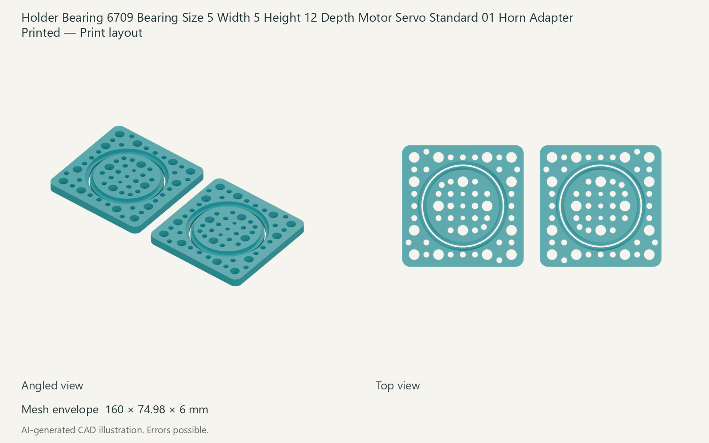
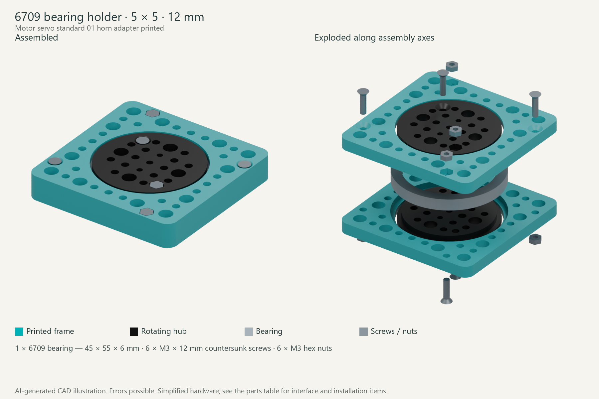

<!-- oobb-presentation:start -->
# Oobb Part Holder Bearing 6709 Bearing Size 5 Width 5 Height 12 Depth Motor Servo Standard 01 Horn Adapter Printed

AI-generated images and instructions. Errors possible.

## Summary

Parametric bearing holders with bearing-size, holder-style and mounting variants.

This is an entirely AI-generated coding project. The generated outputs are included and usually work, but the main purpose of publishing it is to give others a starting point for modifying the project with their own AI tools.



## Details

**Full OOMP ID:** `oobb_part_holder_bearing_6709_bearing_size_5_width_5_height_12_depth_motor_servo_standard_01_horn_adapter_printed`

[Part folder](../../../../../../../../../../parts/oobb_part_holder_bearing_6709_bearing_size_5_width_5_height_12_depth_motor_servo_standard_01_horn_adapter_printed/) · [OOBB navigation](../../../../../../../../../)

| Field | Value |
| --- | --- |
| Bearing Depth | 6 |
| Bearing Inner Diameter | 45 |
| Bearing Outer Diameter | 55 |
| Bearing Print Radial Clearance | 0.2 |
| Bearing Size | 6709 |
| Body | plate |
| Depth | 12 |
| Extra | motor_servo_standard_01_horn_adapter_printed |
| Height | 5 |
| Holder Type | holder |
| Horn Adapter | printed |
| Inner Joining Rotation | 45 |
| Interior Radius Name | m3 |
| Mounting Minimum Web | 0.3 |
| Oobb Name | bearing_holder |
| Prepare Print | True |
| Print Gap | 10 |
| Shaft | motor_servo_standard_01 |
| Split | True |
| Split Z | 0 |
| Width | 5 |
| Taxonomy | oobb / part / holder / bearing / 6709_bearing_size / 5_width / 5_height / 12_depth / motor_servo_standard_01_horn_adapter_printed |

<details>
<summary>Full part details: all working.yaml fields</summary>

```yaml
bearing_depth: 6
bearing_dimension_source: https://www.cxnjs.com/content/150.html
bearing_inner_diameter: 45
bearing_outer_diameter: 55
bearing_print_radial_clearance: 0.2
bearing_size: '6709'
bip_39_2_word_array:
- dish
- aware
bip_39_2_word_no_space: dishaware
bip_39_2_word_space: dish aware
bip_39_2_word_underscore: dish_aware
bip_39_3_word_array:
- dish
- aware
- reward
bip_39_3_word_no_space: dishawarereward
bip_39_3_word_space: dish aware reward
bip_39_3_word_underscore: dish_aware_reward
bip_39_full_array:
- dish
- aware
- reward
- grass
- home
- rebuild
- job
- weather
- bag
- canvas
- glance
- dice
bip_39_full_no_space: dishawarerewardgrasshomerebuildjobweatherbagcanvasglancedice
bip_39_full_space: dish aware reward grass home rebuild job weather bag canvas glance
  dice
bip_39_full_underscore: dish_aware_reward_grass_home_rebuild_job_weather_bag_canvas_glance_dice
depth: 12
directory: parts/oobb_part_holder_bearing_6709_bearing_size_5_width_5_height_12_depth_motor_servo_standard_01_horn_adapter_printed
extra: motor_servo_standard_01_horn_adapter_printed
height: 5
horn_adapter: printed
id: oobb_part_holder_bearing_6709_bearing_size_5_width_5_height_12_depth_motor_servo_standard_01_horn_adapter_printed
id_no_class: oobb_part_holder_bearing_6709_bearing_size_5_width_5_height_12_depth_motor_servo_standard_01_horn_adapter_printed
id_no_size: oobb_part_holder_bearing_6709_bearing_size_5_width_5_height_12_depth_motor_servo_standard_01_horn_adapter_printed
id_no_type: oobb_part_holder_bearing_6709_bearing_size_5_width_5_height_12_depth_motor_servo_standard_01_horn_adapter_printed
id_oobb: oobb_part_holder_bearing_6709_bearing_size_5_width_5_height_12_depth_motor_servo_standard_01_horn_adapter_printed
inner_joining_rotation: 45
kwargs:
  bearing_depth: 6
  bearing_inner_diameter: 45
  bearing_outer_diameter: 55
  bearing_print_radial_clearance: 0.2
  bearing_size: '6709'
  body: plate
  depth: 12
  extra: motor_servo_standard_01_horn_adapter_printed
  filter: ''
  generate_stl: false
  height: 5
  holder_type: holder
  horn_adapter: printed
  inner_joining_rotation: 45
  interior_hole_positions: []
  interior_radius_name: m3
  modes:
  - 3dpr
  - 'true'
  mounting_minimum_web: 0.3
  navigation: false
  oobb_name: bearing_holder
  oomp_description_extra: motor_servo_standard_01_shaft_motor_servo_standard_01_horn_adapter_printed_extra_12_depth
  oomp_description_main: bearing_holder_5_width_5_height
  oomp_mode: project
  oomp_run: false
  overwrite: true
  prepare_print: true
  print_gap: 10
  shaft: motor_servo_standard_01
  split: true
  split_z: 0
  typ: fast
  type: default_bearing_holder
  width: 5
link_github: https://github.com/oomlout/oomlout_oomp_version_1_messy/tree/main/parts/oobb_part_holder_bearing_6709_bearing_size_5_width_5_height_12_depth_motor_servo_standard_01_horn_adapter_printed
link_main: https://github.com/oomlout/oomlout_oomp_version_1_messy/tree/main/parts/oobb_part_holder_bearing_6709_bearing_size_5_width_5_height_12_depth_motor_servo_standard_01_horn_adapter_printed
link_redirect: https://github.com/oomlout/oomlout_oomp_version_1_messy/tree/main/parts/oobb_part_holder_bearing_6709_bearing_size_5_width_5_height_12_depth_motor_servo_standard_01_horn_adapter_printed
md5: 3f220ae2b2f6d1669e07c51184358a9e
md5_10: 3f220ae2b2
md5_10_upper: 3F220AE2B2
md5_5: 3f220
md5_5_upper: 3F220
md5_6: 3f220a
md5_6_alpha: 2goi2
md5_6_alpha_upper: 2GOI2
md5_6_upper: 3F220A
name: Oobb Part Holder Bearing 6709 Bearing Size 5 Width 5 Height 12 Depth Motor Servo
  Standard 01 Horn Adapter Printed
name_no_class: Oobb Part Holder Bearing 6709 Bearing Size 5 Width 5 Height 12 Depth
  Motor Servo Standard 01 Horn Adapter Printed
name_no_size: Oobb Part Holder Bearing 6709 Bearing Size 5 Width 5 Height 12 Depth
  Motor Servo Standard 01 Horn Adapter Printed
name_no_type: Oobb Part Holder Bearing 6709 Bearing Size 5 Width 5 Height 12 Depth
  Motor Servo Standard 01 Horn Adapter Printed
name_proper: Oobb Part Holder Bearing 6709 Bearing Size 5 Width 5 Height 12 Depth
  Motor Servo Standard 01 Horn Adapter Printed
name_space: oobb part holder bearing 6709 bearing size 5 width 5 height 12 depth motor
  servo standard 01 horn adapter printed
name_upper: OOBB PART HOLDER BEARING 6709 BEARING SIZE 5 WIDTH 5 HEIGHT 12 DEPTH MOTOR
  SERVO STANDARD 01 HORN ADAPTER PRINTED
oobb_details:
  bearing_depth: 6
  bearing_inner_diameter: 45
  bearing_outer_diameter: 55
  bearing_print_radial_clearance: 0.2
  bearing_size: '6709'
  body: plate
  depth: 12
  extra: motor_servo_standard_01_horn_adapter_printed
  height: 5
  holder_type: holder
  horn_adapter: printed
  inner_joining_rotation: 45
  interior_hole_positions: []
  interior_radius_name: m3
  mounting_minimum_web: 0.3
  oobb_name: bearing_holder
  prepare_print: true
  print_gap: 10
  shaft: motor_servo_standard_01
  split: true
  split_z: 0
  width: 5
oobb_name: bearing_holder
oomlout_ai_roboclick_1:
  actions:
  - command: text_jinja_template
    convert_to_pdf: false
    convert_to_png: false
    dict_data:
      bearing_depth: 6
      bearing_dimension_source: https://www.cxnjs.com/content/150.html
      bearing_inner_diameter: 45
      bearing_outer_diameter: 55
      bearing_print_radial_clearance: 0.2
      bearing_size: '6709'
      depth: 12
      directory: parts\oobb_part_holder_bearing_6709_bearing_size_5_width_5_height_12_depth_motor_servo_standard_01_horn_adapter_printed
      extra: motor_servo_standard_01_horn_adapter_printed
      height: 5
      horn_adapter: printed
      id: oobb_part_holder_bearing_6709_bearing_size_5_width_5_height_12_depth_motor_servo_standard_01_horn_adapter_printed
      inner_joining_rotation: 45
      name: oobb_part_holder_bearing_6709_bearing_size_5_width_5_height_12_depth_motor_servo_standard_01_horn_adapter_printed
      name_proper: Oobb Part Holder Bearing 6709 Bearing Size 5 Width 5 Height 12
        Depth Motor Servo Standard 01 Horn Adapter Printed
      name_space: oobb part holder bearing 6709 bearing size 5 width 5 height 12 depth
        motor servo standard 01 horn adapter printed
      name_upper: OOBB PART HOLDER BEARING 6709 BEARING SIZE 5 WIDTH 5 HEIGHT 12 DEPTH
        MOTOR SERVO STANDARD 01 HORN ADAPTER PRINTED
      oobb_details:
        bearing_depth: 6
        bearing_inner_diameter: 45
        bearing_outer_diameter: 55
        bearing_print_radial_clearance: 0.2
        bearing_size: '6709'
        body: plate
        depth: 12
        extra: motor_servo_standard_01_horn_adapter_printed
        height: 5
        holder_type: holder
        horn_adapter: printed
        inner_joining_rotation: 45
        interior_hole_positions: []
        interior_radius_name: m3
        mounting_minimum_web: 0.3
        oobb_name: bearing_holder
        prepare_print: true
        print_gap: 10
        shaft: motor_servo_standard_01
        split: true
        split_z: 0
        width: 5
      shaft: motor_servo_standard_01
      taxonomy_1: oobb
      taxonomy_10: ''
      taxonomy_11: ''
      taxonomy_12: ''
      taxonomy_13: ''
      taxonomy_14: ''
      taxonomy_15: ''
      taxonomy_2: part
      taxonomy_3: holder
      taxonomy_4: bearing
      taxonomy_5: 6709_bearing_size
      taxonomy_6: 5_width
      taxonomy_7: 5_height
      taxonomy_8: 12_depth
      taxonomy_9: motor_servo_standard_01_horn_adapter_printed
      url_chat: ''
      width: 5
    dict_data_files: {}
    dict_data_files_exists: {}
    file_output: label_oomp.svg
    file_template: C:\gh\oomlout_oobb_part_holder_bearing_version_5\source_file\template_jinja\template_jinja_label_oomlout_76_2_mm_50_8_mm\working.svg.j2
    search_and_replace: []
  file_test: label_oomp.pdf
  retries_until_complete: 0
oomp_key: oomp_oobb_part_holder_bearing_6709_bearing_size_5_width_5_height_12_depth_motor_servo_standard_01_horn_adapter_printed
project_name: C:\gh\oomlout_oobb_part_holder_bearing_version_5
shaft: motor_servo_standard_01
taxonomy_1: oobb
taxonomy_10: ''
taxonomy_11: ''
taxonomy_12: ''
taxonomy_13: ''
taxonomy_14: ''
taxonomy_15: ''
taxonomy_1_capital: Oobb
taxonomy_1_first_letter: o
taxonomy_1_first_letter_upper: O
taxonomy_1_length_1: o
taxonomy_1_length_2: oo
taxonomy_1_length_3: oob
taxonomy_1_length_4: oobb
taxonomy_1_length_5: oobb
taxonomy_1_upper: OOBB
taxonomy_1_upper_length_1: O
taxonomy_1_upper_length_2: OO
taxonomy_1_upper_length_3: OOB
taxonomy_1_upper_length_4: OOBB
taxonomy_1_upper_length_5: OOBB
taxonomy_2: part
taxonomy_2_capital: Part
taxonomy_2_first_letter: p
taxonomy_2_first_letter_upper: P
taxonomy_2_length_1: p
taxonomy_2_length_2: pa
taxonomy_2_length_3: par
taxonomy_2_length_4: part
taxonomy_2_length_5: part
taxonomy_2_upper: PART
taxonomy_2_upper_length_1: P
taxonomy_2_upper_length_2: PA
taxonomy_2_upper_length_3: PAR
taxonomy_2_upper_length_4: PART
taxonomy_2_upper_length_5: PART
taxonomy_3: holder
taxonomy_3_capital: Holder
taxonomy_3_first_letter: h
taxonomy_3_first_letter_upper: H
taxonomy_3_length_1: h
taxonomy_3_length_2: ho
taxonomy_3_length_3: hol
taxonomy_3_length_4: hold
taxonomy_3_length_5: holde
taxonomy_3_upper: HOLDER
taxonomy_3_upper_length_1: H
taxonomy_3_upper_length_2: HO
taxonomy_3_upper_length_3: HOL
taxonomy_3_upper_length_4: HOLD
taxonomy_3_upper_length_5: HOLDE
taxonomy_4: bearing
taxonomy_4_capital: Bearing
taxonomy_4_first_letter: b
taxonomy_4_first_letter_upper: B
taxonomy_4_length_1: b
taxonomy_4_length_2: be
taxonomy_4_length_3: bea
taxonomy_4_length_4: bear
taxonomy_4_length_5: beari
taxonomy_4_upper: BEARING
taxonomy_4_upper_length_1: B
taxonomy_4_upper_length_2: BE
taxonomy_4_upper_length_3: BEA
taxonomy_4_upper_length_4: BEAR
taxonomy_4_upper_length_5: BEARI
taxonomy_5: 6709_bearing_size
taxonomy_5_capital: 6709 Bearing Size
taxonomy_5_first_letter: '6'
taxonomy_5_first_letter_upper: '6'
taxonomy_5_length_1: '6'
taxonomy_5_length_2: '67'
taxonomy_5_length_3: '670'
taxonomy_5_length_4: '6709'
taxonomy_5_length_5: '6709_'
taxonomy_5_upper: 6709_BEARING_SIZE
taxonomy_5_upper_length_1: '6'
taxonomy_5_upper_length_2: '67'
taxonomy_5_upper_length_3: '670'
taxonomy_5_upper_length_4: '6709'
taxonomy_5_upper_length_5: '6709_'
taxonomy_6: 5_width
taxonomy_6_capital: 5 Width
taxonomy_6_first_letter: '5'
taxonomy_6_first_letter_upper: '5'
taxonomy_6_length_1: '5'
taxonomy_6_length_2: '5_'
taxonomy_6_length_3: 5_w
taxonomy_6_length_4: 5_wi
taxonomy_6_length_5: 5_wid
taxonomy_6_upper: 5_WIDTH
taxonomy_6_upper_length_1: '5'
taxonomy_6_upper_length_2: '5_'
taxonomy_6_upper_length_3: 5_W
taxonomy_6_upper_length_4: 5_WI
taxonomy_6_upper_length_5: 5_WID
taxonomy_7: 5_height
taxonomy_7_capital: 5 Height
taxonomy_7_first_letter: '5'
taxonomy_7_first_letter_upper: '5'
taxonomy_7_length_1: '5'
taxonomy_7_length_2: '5_'
taxonomy_7_length_3: 5_h
taxonomy_7_length_4: 5_he
taxonomy_7_length_5: 5_hei
taxonomy_7_upper: 5_HEIGHT
taxonomy_7_upper_length_1: '5'
taxonomy_7_upper_length_2: '5_'
taxonomy_7_upper_length_3: 5_H
taxonomy_7_upper_length_4: 5_HE
taxonomy_7_upper_length_5: 5_HEI
taxonomy_8: 12_depth
taxonomy_8_capital: 12 Depth
taxonomy_8_first_letter: '1'
taxonomy_8_first_letter_upper: '1'
taxonomy_8_length_1: '1'
taxonomy_8_length_2: '12'
taxonomy_8_length_3: '12_'
taxonomy_8_length_4: 12_d
taxonomy_8_length_5: 12_de
taxonomy_8_upper: 12_DEPTH
taxonomy_8_upper_length_1: '1'
taxonomy_8_upper_length_2: '12'
taxonomy_8_upper_length_3: '12_'
taxonomy_8_upper_length_4: 12_D
taxonomy_8_upper_length_5: 12_DE
taxonomy_9: motor_servo_standard_01_horn_adapter_printed
taxonomy_9_capital: Motor Servo Standard 01 Horn Adapter Printed
taxonomy_9_first_letter: m
taxonomy_9_first_letter_upper: M
taxonomy_9_length_1: m
taxonomy_9_length_2: mo
taxonomy_9_length_3: mot
taxonomy_9_length_4: moto
taxonomy_9_length_5: motor
taxonomy_9_upper: MOTOR_SERVO_STANDARD_01_HORN_ADAPTER_PRINTED
taxonomy_9_upper_length_1: M
taxonomy_9_upper_length_2: MO
taxonomy_9_upper_length_3: MOT
taxonomy_9_upper_length_4: MOTO
taxonomy_9_upper_length_5: MOTOR
url_chat: ''
width: 5
```

</details>

## Parts

Quantities for one complete printed holder/adapter, plus its listed interface. Installation fasteners are application-specific.

| Part | Quantity | Type | Use |
| --- | ---: | --- | --- |
| Printed frame halves | 2 | Print | Print all frame pieces in 3dpr.stl once |
| Printed hub pieces | 2 | Print | Print all hub pieces in 3dpr.stl once; preserve complementary faces |
| 6709 bearing — 45 × 55 × 6 mm | 1 | Hardware | Bore × outside diameter × width |
| M3 × 12 mm countersunk screws | 6 | Hardware | Join printed halves; follow the alternating head/nut faces |
| M3 hex nuts | 6 | Hardware | Opposite-face joining pockets |
| servo standard 01 motor / mating shaft | 1 | Interface | Use the specified shaft interface; motor and mounting hardware are not shown |
| M3 threaded inserts | 2 | Interface | CAD insert pockets: 4 mm diameter; choose compatible insert depth and fit |
| M3 insert mounting screws | 2 | Interface | Length depends on the mating component and selected insert; do not bottom out |
| M2.5 servo retaining screw | 1 | Interface | Match the servo thread and required engagement; length is servo-specific |
| M2 self-tapping horn screws | 2 | Interface | At y = ±7.375 mm; choose length for the actual horn and hub |

[Machine-readable parts list](../../../../../../../../../../parts/oobb_part_holder_bearing_6709_bearing_size_5_width_5_height_12_depth_motor_servo_standard_01_horn_adapter_printed/assembly.json) · [CSV parts list](../../../../../../../../../../parts/oobb_part_holder_bearing_6709_bearing_size_5_width_5_height_12_depth_motor_servo_standard_01_horn_adapter_printed/assembly_parts.csv)

## Assembly




1. Print one complete 3dpr.stl layout. Keep the complementary frame and hub pieces in their matching orientation.

2. Load any captive nuts, coupler nuts or inserts while their pockets are accessible. Seat each bearing between its matching hub and frame pieces.

3. Close the complementary pieces and fit the listed joining screws and nuts, following the alternating head and nut recesses.

4. Fit the specified shaft or motor interface. Check free rotation before fastening the holder to the surrounding structure.


Bearing rings and fasteners are simplified nominal illustrations; threads, drive sockets, inserts and motor/interface hardware are omitted. Installation bolts depend on the surrounding assembly.


[Variant assembly notes](../../../../../../../../../../PROJECT_GUIDE.md)
<!-- oobb-presentation:end -->
