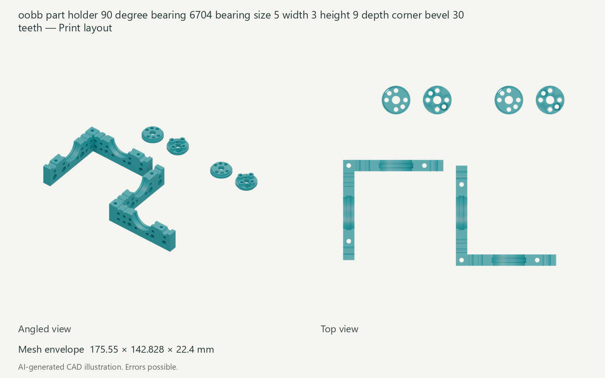
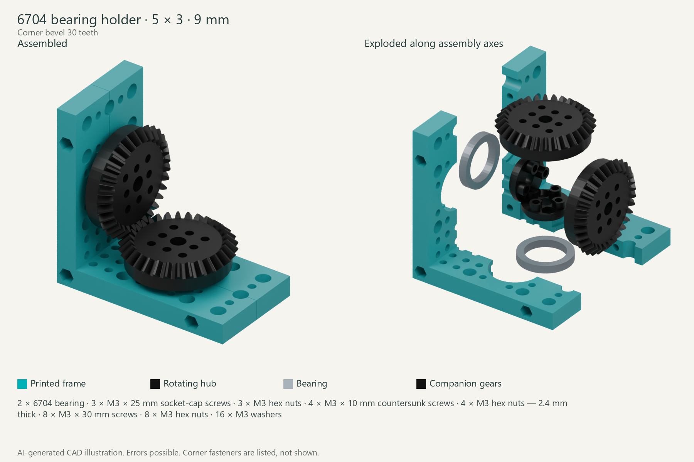

<!-- oobb-presentation:start -->
# Oobb Part Holder 90 Degree Bearing 6704 Bearing Size 5 Width 3 Height 9 Depth Corner Bevel 30 Teeth

AI-generated images and instructions. Errors possible.

## Summary

Parametric bearing holders with bearing-size, holder-style and mounting variants.

This is an entirely AI-generated coding project. The generated outputs are included and usually work, but the main purpose of publishing it is to give others a starting point for modifying the project with their own AI tools.



## Details

**Full OOMP ID:** `oobb_part_holder_90_degree_bearing_6704_bearing_size_5_width_3_height_9_depth_corner_bevel_30_teeth`

[Part folder](../../../../../../../../../../parts/oobb_part_holder_90_degree_bearing_6704_bearing_size_5_width_3_height_9_depth_corner_bevel_30_teeth/) · [OOBB navigation](../../../../../../../../../)

| Field | Value |
| --- | --- |
| Bearing Size | 6704 |
| Body | plate |
| Depth | 9 |
| Extra | corner_bevel_30_teeth |
| Height | 3 |
| Holder Type | holder_90_degree |
| Horn Adapter |  |
| Inner Joining Rotation | 45 |
| Interior Radius Name | m3 |
| Mounting Minimum Web | 0.3 |
| Oobb Name | bearing_holder_corner |
| Prepare Print | True |
| Print Gap | 10 |
| Shaft | m6 |
| Split | True |
| Split Z | 0 |
| Width | 5 |
| Taxonomy | oobb / part / holder_90_degree / bearing / 6704_bearing_size / 5_width / 3_height / 9_depth / corner_bevel_30_teeth |

<details>
<summary>Full part details: all working.yaml fields</summary>

```yaml
bearing_size: '6704'
corner:
  axial_clearance: 0.2
  axis_pitch: 7.5
  bearing_depth: 4
  bearing_inner_diameter: 20
  bearing_outer_diameter: 27
  gear_backlash: 0.2
  gear_depth: 12
  gear_face_width: 6
  gear_join_access: true
  gear_module: 1.5
  gear_mount_radius_name: m3
  gear_mounts:
  - - -7.5
    - 0
  - - 7.5
    - 0
  - - 0
    - -7.5
  - - 0
    - 7.5
  gear_pad_radius: 3
  gear_repo: ../oomlout_oobb_gear_version_5
  gear_teeth: 30
  hub_nut_depth: 2.4
  joining_screw_length: 25
  minimum_gear_gap: 1
  mounting_row: 30
  radial_clearance: 0.15
  split_gap: 0.2
depth: 9
extra: corner_bevel_30_teeth
height: 3
holder_type: holder_90_degree
id: oobb_part_holder_90_degree_bearing_6704_bearing_size_5_width_3_height_9_depth_corner_bevel_30_teeth
id_oobb: oobb_part_holder_90_degree_bearing_6704_bearing_size_5_width_3_height_9_depth_corner_bevel_30_teeth
inner_joining_rotation: 45
kwargs:
  bearing_size: '6704'
  body: plate
  corner:
    axial_clearance: 0.2
    axis_pitch: 7.5
    bearing_depth: 4
    bearing_inner_diameter: 20
    bearing_outer_diameter: 27
    gear_backlash: 0.2
    gear_depth: 12
    gear_face_width: 6
    gear_join_access: true
    gear_module: 1.5
    gear_mount_radius_name: m3
    gear_mounts:
    - - -7.5
      - 0
    - - 7.5
      - 0
    - - 0
      - -7.5
    - - 0
      - 7.5
    gear_pad_radius: 3
    gear_repo: ../oomlout_oobb_gear_version_5
    gear_teeth: 30
    hub_nut_depth: 2.4
    joining_screw_length: 25
    minimum_gear_gap: 1
    mounting_row: 30
    radial_clearance: 0.15
    split_gap: 0.2
  depth: 9
  extra: corner_bevel_30_teeth
  height: 3
  holder_type: holder_90_degree
  horn_adapter: ''
  inner_joining_rotation: 45
  interior_hole_positions: []
  interior_radius_name: m3
  modes:
  - 3dpr
  mounting_minimum_web: 0.3
  oobb_name: bearing_holder_corner
  oomp_description_extra: m6_shaft_corner_bevel_30_teeth_extra_9_depth
  oomp_description_main: bearing_holder_corner_5_width_3_height
  overwrite: true
  prepare_print: true
  print_gap: 10
  shaft: m6
  split: true
  split_z: 0
  type: default_bearing_holder_corner
  width: 5
oobb_details:
  bearing_size: '6704'
  body: plate
  corner:
    axial_clearance: 0.2
    axis_pitch: 7.5
    bearing_depth: 4
    bearing_inner_diameter: 20
    bearing_outer_diameter: 27
    gear_backlash: 0.2
    gear_depth: 12
    gear_face_width: 6
    gear_join_access: true
    gear_module: 1.5
    gear_mount_radius_name: m3
    gear_mounts:
    - - -7.5
      - 0
    - - 7.5
      - 0
    - - 0
      - -7.5
    - - 0
      - 7.5
    gear_pad_radius: 3
    gear_repo: ../oomlout_oobb_gear_version_5
    gear_teeth: 30
    hub_nut_depth: 2.4
    joining_screw_length: 25
    minimum_gear_gap: 1
    mounting_row: 30
    radial_clearance: 0.15
    split_gap: 0.2
  depth: 9
  extra: corner_bevel_30_teeth
  height: 3
  holder_type: holder_90_degree
  horn_adapter: ''
  inner_joining_rotation: 45
  interior_hole_positions: []
  interior_radius_name: m3
  mounting_minimum_web: 0.3
  oobb_name: bearing_holder_corner
  prepare_print: true
  print_gap: 10
  shaft: m6
  split: true
  split_z: 0
  width: 5
oobb_name: bearing_holder_corner
project_name: C:\gh\oomlout_oobb_part_holder_bearing_version_5
taxonomy_1: oobb
taxonomy_10: ''
taxonomy_11: ''
taxonomy_12: ''
taxonomy_13: ''
taxonomy_14: ''
taxonomy_15: ''
taxonomy_2: part
taxonomy_3: holder_90_degree
taxonomy_4: bearing
taxonomy_5: 6704_bearing_size
taxonomy_6: 5_width
taxonomy_7: 3_height
taxonomy_8: 9_depth
taxonomy_9: corner_bevel_30_teeth
width: 5
```

</details>

## Parts

Quantities for one complete printed holder/adapter, plus its listed interface. Installation fasteners are application-specific.

| Part | Quantity | Type | Use |
| --- | ---: | --- | --- |
| Printed connected corner halves | 2 | Print | One of each complementary half |
| Printed hub discs | 4 | Print | Two outer discs and two gear-facing discs; supplied hub files each contain two copies |
| Matching 30-tooth backed bevel gears | 2 | Print | Use examples/corner_6704/components/gear.stl; retained companion oobb_part_gear_big_scale_3_diameter_30_teeth_bevel_style_12_mm_depth |
| 6704 bearing | 2 | Hardware | One on each perpendicular axis |
| M3 × 25 mm socket-cap screws | 3 | Hardware | Connected corner seam |
| M3 hex nuts | 3 | Hardware | Seam pockets |
| M3 × 10 mm countersunk screws | 4 | Hardware | Two joins per bearing hub |
| M3 hex nuts — 2.4 mm thick | 4 | Hardware | Hub joins |
| M3 × 30 mm screws | 8 | Hardware | Four per gear; suggested stack from the existing corner guide |
| M3 hex nuts | 8 | Hardware | Gear connections |
| M3 washers | 16 | Hardware | One under each gear screw head and nut; check final protrusion |

[Machine-readable parts list](../../../../../../../../../../parts/oobb_part_holder_90_degree_bearing_6704_bearing_size_5_width_3_height_9_depth_corner_bevel_30_teeth/assembly.json) · [CSV parts list](../../../../../../../../../../parts/oobb_part_holder_90_degree_bearing_6704_bearing_size_5_width_3_height_9_depth_corner_bevel_30_teeth/assembly_parts.csv)

## Assembly




1. Join each bearing between an outer hub disc and a gear-facing hub disc, with the stand-offs facing the gear.

2. Capture both bearing/hub units between the connected corner halves; fit the three seam screws and nuts.

3. Bolt on the matching gears, rotate the second hub and gear together to mesh, and check free movement.


Corner diagram shows printed parts and bearings. Seam, hub and gear fasteners are listed in the table; see the linked corner guide for their insertion paths and suggested lengths.


[Variant assembly notes](../../../../../../../../../../examples/corner_6704/README.md)
<!-- oobb-presentation:end -->
