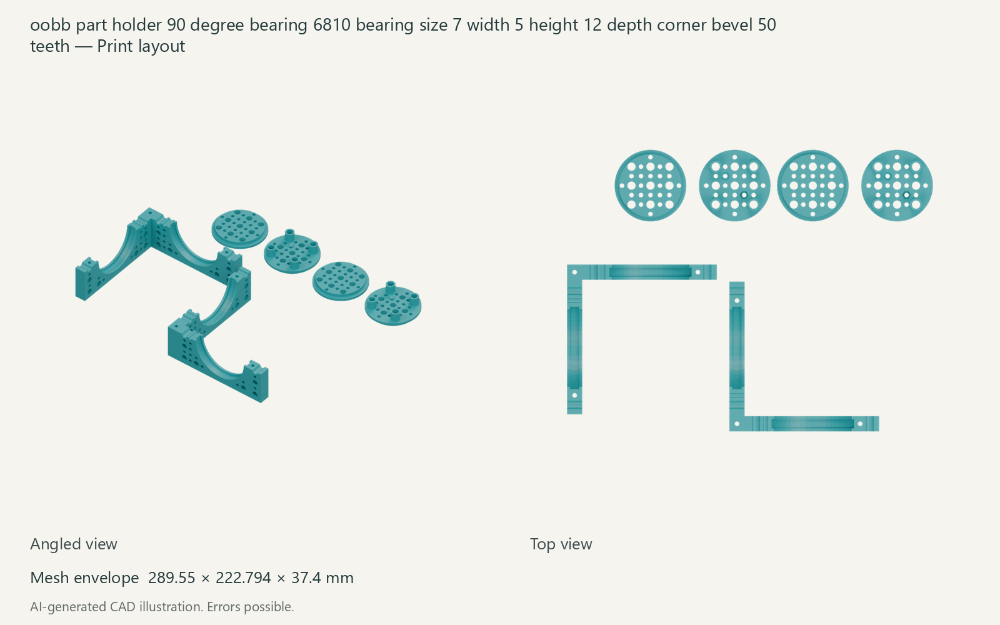

<!-- oobb-presentation:start -->
# Oobb Part Holder 90 Degree Bearing 6810 Bearing Size 7 Width 5 Height 12 Depth Corner Bevel 50 Teeth

AI-generated images and instructions. Errors possible.

## Summary

Parametric bearing holders with bearing-size, holder-style and mounting variants.

This is an entirely AI-generated coding project. The generated outputs are included and usually work, but the main purpose of publishing it is to give others a starting point for modifying the project with their own AI tools.



## Details

**Full OOMP ID:** `oobb_part_holder_90_degree_bearing_6810_bearing_size_7_width_5_height_12_depth_corner_bevel_50_teeth`

[Part folder](./) · [OOBB navigation](../../navigation_oobb/)

| Field | Value |
| --- | --- |
| Bearing Size | 6810 |
| Body | plate |
| Depth | 12 |
| Extra | corner_bevel_50_teeth |
| Height | 5 |
| Holder Type | holder_90_degree |
| Horn Adapter |  |
| Inner Joining Rotation | 45 |
| Interior Radius Name | m3 |
| Mounting Minimum Web | 0.3 |
| Oobb Name | bearing_holder_corner |
| Prepare Print | True |
| Print Gap | 10 |
| Shaft | m6 |
| Split | True |
| Split Z | 0 |
| Width | 7 |
| Taxonomy | oobb / part / holder_90_degree / bearing / 6810_bearing_size / 7_width / 5_height / 12_depth / corner_bevel_50_teeth |

<details>
<summary>Full part details: all working.yaml fields</summary>

```yaml
bearing_size: '6810'
corner:
  axial_clearance: 0.2
  bearing_depth: 7
  bearing_inner_diameter: 50
  bearing_outer_diameter: 65
  gear_backlash: 0.2
  gear_depth: 12
  gear_face_width: 6
  gear_module: 1.5
  gear_repo: ../oomlout_oobb_gear_version_5
  gear_teeth: 50
  joining_screw_length: 25
  minimum_gear_gap: 1
  mounting_row: 45
  radial_clearance: 0.15
  split_gap: 0.2
depth: 12
extra: corner_bevel_50_teeth
height: 5
holder_type: holder_90_degree
id: oobb_part_holder_90_degree_bearing_6810_bearing_size_7_width_5_height_12_depth_corner_bevel_50_teeth
id_oobb: oobb_part_holder_90_degree_bearing_6810_bearing_size_7_width_5_height_12_depth_corner_bevel_50_teeth
inner_joining_positions: &id001
- - -7.5
  - 7.5
- - 7.5
  - -7.5
inner_joining_rotation: 45
kwargs:
  bearing_size: '6810'
  body: plate
  corner:
    axial_clearance: 0.2
    bearing_depth: 7
    bearing_inner_diameter: 50
    bearing_outer_diameter: 65
    gear_backlash: 0.2
    gear_depth: 12
    gear_face_width: 6
    gear_module: 1.5
    gear_repo: ../oomlout_oobb_gear_version_5
    gear_teeth: 50
    joining_screw_length: 25
    minimum_gear_gap: 1
    mounting_row: 45
    radial_clearance: 0.15
    split_gap: 0.2
  depth: 12
  extra: corner_bevel_50_teeth
  height: 5
  holder_type: holder_90_degree
  horn_adapter: ''
  inner_joining_positions:
  - - -7.5
    - 7.5
  - - 7.5
    - -7.5
  inner_joining_rotation: 45
  interior_hole_positions: []
  interior_radius_name: m3
  modes:
  - 3dpr
  mounting_minimum_web: 0.3
  oobb_name: bearing_holder_corner
  oomp_description_extra: m6_shaft_corner_bevel_50_teeth_extra_12_depth
  oomp_description_main: bearing_holder_corner_7_width_5_height
  overwrite: true
  prepare_print: true
  print_gap: 10
  shaft: m6
  split: true
  split_z: 0
  type: default_bearing_holder_corner
  width: 7
oobb_details:
  bearing_size: '6810'
  body: plate
  corner:
    axial_clearance: 0.2
    bearing_depth: 7
    bearing_inner_diameter: 50
    bearing_outer_diameter: 65
    gear_backlash: 0.2
    gear_depth: 12
    gear_face_width: 6
    gear_module: 1.5
    gear_repo: ../oomlout_oobb_gear_version_5
    gear_teeth: 50
    joining_screw_length: 25
    minimum_gear_gap: 1
    mounting_row: 45
    radial_clearance: 0.15
    split_gap: 0.2
  depth: 12
  extra: corner_bevel_50_teeth
  height: 5
  holder_type: holder_90_degree
  horn_adapter: ''
  inner_joining_positions: *id001
  inner_joining_rotation: 45
  interior_hole_positions: []
  interior_radius_name: m3
  mounting_minimum_web: 0.3
  oobb_name: bearing_holder_corner
  prepare_print: true
  print_gap: 10
  shaft: m6
  split: true
  split_z: 0
  width: 7
oobb_name: bearing_holder_corner
project_name: C:\gh\oomlout_oobb_part_holder_bearing_version_5
taxonomy_1: oobb
taxonomy_10: ''
taxonomy_11: ''
taxonomy_12: ''
taxonomy_13: ''
taxonomy_14: ''
taxonomy_15: ''
taxonomy_2: part
taxonomy_3: holder_90_degree
taxonomy_4: bearing
taxonomy_5: 6810_bearing_size
taxonomy_6: 7_width
taxonomy_7: 5_height
taxonomy_8: 12_depth
taxonomy_9: corner_bevel_50_teeth
width: 7
```

</details>

## Parts

Select the bearing size and holder style in navigation. Printed holder components and purchased bearings are distinct; the preview is generated from the printable mesh.

## Assembly

Follow the selected part’s split, preparation and embedded-nut metadata. Check bearing fit and retain the existing project examples for the applicable assembly.

[Project guide and existing assembly notes](../../PROJECT_GUIDE.md)
<!-- oobb-presentation:end -->
