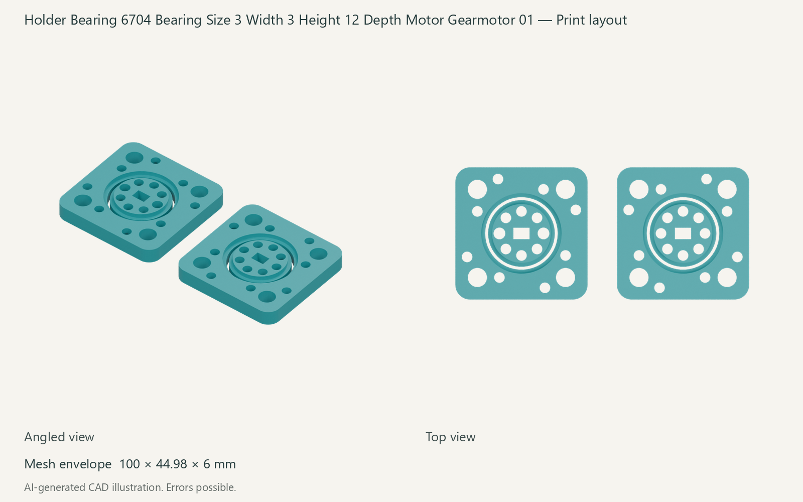

<!-- oobb-presentation:start -->
# Oobb Part Holder Bearing 6704 Bearing Size 3 Width 3 Height 12 Depth Motor Gearmotor 01

AI-generated images and instructions. Errors possible.

## Summary

Parametric bearing holders with bearing-size, holder-style and mounting variants.

This is an entirely AI-generated coding project. The generated outputs are included and usually work, but the main purpose of publishing it is to give others a starting point for modifying the project with their own AI tools.



## Details

**Full OOMP ID:** `oobb_part_holder_bearing_6704_bearing_size_3_width_3_height_12_depth_motor_gearmotor_01`

[Part folder](./) · [OOBB navigation](../../navigation_oobb/)

| Field | Value |
| --- | --- |
| Bearing Size | 6704 |
| Body | plate |
| Depth | 12 |
| Extra | motor_gearmotor_01 |
| Height | 3 |
| Holder Type | holder |
| Horn Adapter |  |
| Inner Joining Rotation | 45 |
| Interior Radius Name | m3 |
| Mounting Minimum Web | 0.3 |
| Oobb Name | bearing_holder |
| Prepare Print | True |
| Print Gap | 10 |
| Shaft | motor_gearmotor_01 |
| Split | True |
| Split Z | 0 |
| Width | 3 |
| Taxonomy | oobb / part / holder / bearing / 6704_bearing_size / 3_width / 3_height / 12_depth / motor_gearmotor_01 |

<details>
<summary>Full part details: all working.yaml fields</summary>

```yaml
bearing_size: '6704'
bip_39_2_word_array:
- vital
- post
bip_39_2_word_no_space: vitalpost
bip_39_2_word_space: vital post
bip_39_2_word_underscore: vital_post
bip_39_3_word_array:
- vital
- post
- notice
bip_39_3_word_no_space: vitalpostnotice
bip_39_3_word_space: vital post notice
bip_39_3_word_underscore: vital_post_notice
bip_39_full_array:
- vital
- post
- notice
- burst
- young
- vehicle
- program
- want
- series
- sleep
- tobacco
- stove
bip_39_full_no_space: vitalpostnoticeburstyoungvehicleprogramwantseriessleeptobaccostove
bip_39_full_space: vital post notice burst young vehicle program want series sleep
  tobacco stove
bip_39_full_underscore: vital_post_notice_burst_young_vehicle_program_want_series_sleep_tobacco_stove
depth: 12
directory: parts/oobb_part_holder_bearing_6704_bearing_size_3_width_3_height_12_depth_motor_gearmotor_01
extra: motor_gearmotor_01
height: 3
id: oobb_part_holder_bearing_6704_bearing_size_3_width_3_height_12_depth_motor_gearmotor_01
id_no_class: oobb_part_holder_bearing_6704_bearing_size_3_width_3_height_12_depth_motor_gearmotor_01
id_no_size: oobb_part_holder_bearing_6704_bearing_size_3_width_3_height_12_depth_motor_gearmotor_01
id_no_type: oobb_part_holder_bearing_6704_bearing_size_3_width_3_height_12_depth_motor_gearmotor_01
id_oobb: oobb_part_holder_bearing_6704_bearing_size_3_width_3_height_12_depth_motor_gearmotor_01
inner_joining_rotation: 45
kwargs:
  bearing_size: '6704'
  body: plate
  depth: 12
  extra: motor_gearmotor_01
  filter: ''
  generate_stl: false
  height: 3
  holder_type: holder
  horn_adapter: ''
  inner_joining_rotation: 45
  interior_hole_positions: []
  interior_radius_name: m3
  modes:
  - 3dpr
  - 'true'
  mounting_minimum_web: 0.3
  navigation: false
  oobb_name: bearing_holder
  oomp_description_extra: motor_gearmotor_01_shaft_motor_gearmotor_01_extra_12_depth
  oomp_description_main: bearing_holder_3_width_3_height
  oomp_mode: project
  oomp_run: false
  overwrite: true
  prepare_print: true
  print_gap: 10
  shaft: motor_gearmotor_01
  split: true
  split_z: 0
  typ: fast
  type: default_bearing_holder
  width: 3
legacy_id: oobb_bearing_plate_03_03_12_6704_sh_motor_gearmotor_01
legacy_source: C:/gh/oomlout_oobb_version_3/things/oobb_bearing_plate_03_03_12_6704_sh_motor_gearmotor_01
link_github: https://github.com/oomlout/oomlout_oomp_version_1_messy/tree/main/parts/oobb_part_holder_bearing_6704_bearing_size_3_width_3_height_12_depth_motor_gearmotor_01
link_main: https://github.com/oomlout/oomlout_oomp_version_1_messy/tree/main/parts/oobb_part_holder_bearing_6704_bearing_size_3_width_3_height_12_depth_motor_gearmotor_01
link_redirect: https://github.com/oomlout/oomlout_oomp_version_1_messy/tree/main/parts/oobb_part_holder_bearing_6704_bearing_size_3_width_3_height_12_depth_motor_gearmotor_01
md5: f515165b8f6ff5e3eaffb7c419678ceb
md5_10: f515165b8f
md5_10_upper: F515165B8F
md5_5: f5151
md5_5_upper: F5151
md5_6: f51516
md5_6_alpha: 9k9au
md5_6_alpha_upper: 9K9AU
md5_6_upper: F51516
name: Oobb Part Holder Bearing 6704 Bearing Size 3 Width 3 Height 12 Depth Motor Gearmotor
  01
name_no_class: Oobb Part Holder Bearing 6704 Bearing Size 3 Width 3 Height 12 Depth
  Motor Gearmotor 01
name_no_size: Oobb Part Holder Bearing 6704 Bearing Size 3 Width 3 Height 12 Depth
  Motor Gearmotor 01
name_no_type: Oobb Part Holder Bearing 6704 Bearing Size 3 Width 3 Height 12 Depth
  Motor Gearmotor 01
name_proper: Oobb Part Holder Bearing 6704 Bearing Size 3 Width 3 Height 12 Depth
  Motor Gearmotor 01
name_space: oobb part holder bearing 6704 bearing size 3 width 3 height 12 depth motor
  gearmotor 01
name_upper: OOBB PART HOLDER BEARING 6704 BEARING SIZE 3 WIDTH 3 HEIGHT 12 DEPTH MOTOR
  GEARMOTOR 01
oobb_details:
  bearing_size: '6704'
  body: plate
  depth: 12
  extra: motor_gearmotor_01
  height: 3
  holder_type: holder
  horn_adapter: ''
  inner_joining_rotation: 45
  interior_hole_positions: []
  interior_radius_name: m3
  mounting_minimum_web: 0.3
  oobb_name: bearing_holder
  prepare_print: true
  print_gap: 10
  shaft: motor_gearmotor_01
  split: true
  split_z: 0
  width: 3
oobb_name: bearing_holder
oomlout_ai_roboclick_1:
  actions:
  - command: text_jinja_template
    convert_to_pdf: false
    convert_to_png: false
    dict_data:
      bearing_size: '6704'
      depth: 12
      directory: parts\oobb_part_holder_bearing_6704_bearing_size_3_width_3_height_12_depth_motor_gearmotor_01
      extra: motor_gearmotor_01
      height: 3
      id: oobb_part_holder_bearing_6704_bearing_size_3_width_3_height_12_depth_motor_gearmotor_01
      inner_joining_rotation: 45
      legacy_id: oobb_bearing_plate_03_03_12_6704_sh_motor_gearmotor_01
      legacy_source: C:/gh/oomlout_oobb_version_3/things/oobb_bearing_plate_03_03_12_6704_sh_motor_gearmotor_01
      name: oobb_part_holder_bearing_6704_bearing_size_3_width_3_height_12_depth_motor_gearmotor_01
      name_proper: Oobb Part Holder Bearing 6704 Bearing Size 3 Width 3 Height 12
        Depth Motor Gearmotor 01
      name_space: oobb part holder bearing 6704 bearing size 3 width 3 height 12 depth
        motor gearmotor 01
      name_upper: OOBB PART HOLDER BEARING 6704 BEARING SIZE 3 WIDTH 3 HEIGHT 12 DEPTH
        MOTOR GEARMOTOR 01
      oobb_details:
        bearing_size: '6704'
        body: plate
        depth: 12
        extra: motor_gearmotor_01
        height: 3
        holder_type: holder
        horn_adapter: ''
        inner_joining_rotation: 45
        interior_hole_positions: []
        interior_radius_name: m3
        mounting_minimum_web: 0.3
        oobb_name: bearing_holder
        prepare_print: true
        print_gap: 10
        shaft: motor_gearmotor_01
        split: true
        split_z: 0
        width: 3
      shaft: motor_gearmotor_01
      taxonomy_1: oobb
      taxonomy_10: ''
      taxonomy_11: ''
      taxonomy_12: ''
      taxonomy_13: ''
      taxonomy_14: ''
      taxonomy_15: ''
      taxonomy_2: part
      taxonomy_3: holder
      taxonomy_4: bearing
      taxonomy_5: 6704_bearing_size
      taxonomy_6: 3_width
      taxonomy_7: 3_height
      taxonomy_8: 12_depth
      taxonomy_9: motor_gearmotor_01
      url_chat: ''
      width: 3
    dict_data_files: {}
    dict_data_files_exists: {}
    file_output: label_oomp.svg
    file_template: C:\gh\oomlout_oobb_part_holder_bearing_version_5\source_file\template_jinja\template_jinja_label_oomlout_76_2_mm_50_8_mm\working.svg.j2
    search_and_replace: []
  file_test: label_oomp.pdf
  retries_until_complete: 0
oomp_key: oomp_oobb_part_holder_bearing_6704_bearing_size_3_width_3_height_12_depth_motor_gearmotor_01
project_name: C:\gh\oomlout_oobb_part_holder_bearing_version_5
shaft: motor_gearmotor_01
taxonomy_1: oobb
taxonomy_10: ''
taxonomy_11: ''
taxonomy_12: ''
taxonomy_13: ''
taxonomy_14: ''
taxonomy_15: ''
taxonomy_1_capital: Oobb
taxonomy_1_first_letter: o
taxonomy_1_first_letter_upper: O
taxonomy_1_length_1: o
taxonomy_1_length_2: oo
taxonomy_1_length_3: oob
taxonomy_1_length_4: oobb
taxonomy_1_length_5: oobb
taxonomy_1_upper: OOBB
taxonomy_1_upper_length_1: O
taxonomy_1_upper_length_2: OO
taxonomy_1_upper_length_3: OOB
taxonomy_1_upper_length_4: OOBB
taxonomy_1_upper_length_5: OOBB
taxonomy_2: part
taxonomy_2_capital: Part
taxonomy_2_first_letter: p
taxonomy_2_first_letter_upper: P
taxonomy_2_length_1: p
taxonomy_2_length_2: pa
taxonomy_2_length_3: par
taxonomy_2_length_4: part
taxonomy_2_length_5: part
taxonomy_2_upper: PART
taxonomy_2_upper_length_1: P
taxonomy_2_upper_length_2: PA
taxonomy_2_upper_length_3: PAR
taxonomy_2_upper_length_4: PART
taxonomy_2_upper_length_5: PART
taxonomy_3: holder
taxonomy_3_capital: Holder
taxonomy_3_first_letter: h
taxonomy_3_first_letter_upper: H
taxonomy_3_length_1: h
taxonomy_3_length_2: ho
taxonomy_3_length_3: hol
taxonomy_3_length_4: hold
taxonomy_3_length_5: holde
taxonomy_3_upper: HOLDER
taxonomy_3_upper_length_1: H
taxonomy_3_upper_length_2: HO
taxonomy_3_upper_length_3: HOL
taxonomy_3_upper_length_4: HOLD
taxonomy_3_upper_length_5: HOLDE
taxonomy_4: bearing
taxonomy_4_capital: Bearing
taxonomy_4_first_letter: b
taxonomy_4_first_letter_upper: B
taxonomy_4_length_1: b
taxonomy_4_length_2: be
taxonomy_4_length_3: bea
taxonomy_4_length_4: bear
taxonomy_4_length_5: beari
taxonomy_4_upper: BEARING
taxonomy_4_upper_length_1: B
taxonomy_4_upper_length_2: BE
taxonomy_4_upper_length_3: BEA
taxonomy_4_upper_length_4: BEAR
taxonomy_4_upper_length_5: BEARI
taxonomy_5: 6704_bearing_size
taxonomy_5_capital: 6704 Bearing Size
taxonomy_5_first_letter: '6'
taxonomy_5_first_letter_upper: '6'
taxonomy_5_length_1: '6'
taxonomy_5_length_2: '67'
taxonomy_5_length_3: '670'
taxonomy_5_length_4: '6704'
taxonomy_5_length_5: '6704_'
taxonomy_5_upper: 6704_BEARING_SIZE
taxonomy_5_upper_length_1: '6'
taxonomy_5_upper_length_2: '67'
taxonomy_5_upper_length_3: '670'
taxonomy_5_upper_length_4: '6704'
taxonomy_5_upper_length_5: '6704_'
taxonomy_6: 3_width
taxonomy_6_capital: 3 Width
taxonomy_6_first_letter: '3'
taxonomy_6_first_letter_upper: '3'
taxonomy_6_length_1: '3'
taxonomy_6_length_2: '3_'
taxonomy_6_length_3: 3_w
taxonomy_6_length_4: 3_wi
taxonomy_6_length_5: 3_wid
taxonomy_6_upper: 3_WIDTH
taxonomy_6_upper_length_1: '3'
taxonomy_6_upper_length_2: '3_'
taxonomy_6_upper_length_3: 3_W
taxonomy_6_upper_length_4: 3_WI
taxonomy_6_upper_length_5: 3_WID
taxonomy_7: 3_height
taxonomy_7_capital: 3 Height
taxonomy_7_first_letter: '3'
taxonomy_7_first_letter_upper: '3'
taxonomy_7_length_1: '3'
taxonomy_7_length_2: '3_'
taxonomy_7_length_3: 3_h
taxonomy_7_length_4: 3_he
taxonomy_7_length_5: 3_hei
taxonomy_7_upper: 3_HEIGHT
taxonomy_7_upper_length_1: '3'
taxonomy_7_upper_length_2: '3_'
taxonomy_7_upper_length_3: 3_H
taxonomy_7_upper_length_4: 3_HE
taxonomy_7_upper_length_5: 3_HEI
taxonomy_8: 12_depth
taxonomy_8_capital: 12 Depth
taxonomy_8_first_letter: '1'
taxonomy_8_first_letter_upper: '1'
taxonomy_8_length_1: '1'
taxonomy_8_length_2: '12'
taxonomy_8_length_3: '12_'
taxonomy_8_length_4: 12_d
taxonomy_8_length_5: 12_de
taxonomy_8_upper: 12_DEPTH
taxonomy_8_upper_length_1: '1'
taxonomy_8_upper_length_2: '12'
taxonomy_8_upper_length_3: '12_'
taxonomy_8_upper_length_4: 12_D
taxonomy_8_upper_length_5: 12_DE
taxonomy_9: motor_gearmotor_01
taxonomy_9_capital: Motor Gearmotor 01
taxonomy_9_first_letter: m
taxonomy_9_first_letter_upper: M
taxonomy_9_length_1: m
taxonomy_9_length_2: mo
taxonomy_9_length_3: mot
taxonomy_9_length_4: moto
taxonomy_9_length_5: motor
taxonomy_9_upper: MOTOR_GEARMOTOR_01
taxonomy_9_upper_length_1: M
taxonomy_9_upper_length_2: MO
taxonomy_9_upper_length_3: MOT
taxonomy_9_upper_length_4: MOTO
taxonomy_9_upper_length_5: MOTOR
url_chat: ''
width: 3
```

</details>

## Parts

Select the bearing size and holder style in navigation. Printed holder components and purchased bearings are distinct; the preview is generated from the printable mesh.

## Assembly

Follow the selected part’s split, preparation and embedded-nut metadata. Check bearing fit and retain the existing project examples for the applicable assembly.

[Project guide and existing assembly notes](../../PROJECT_GUIDE.md)
<!-- oobb-presentation:end -->
