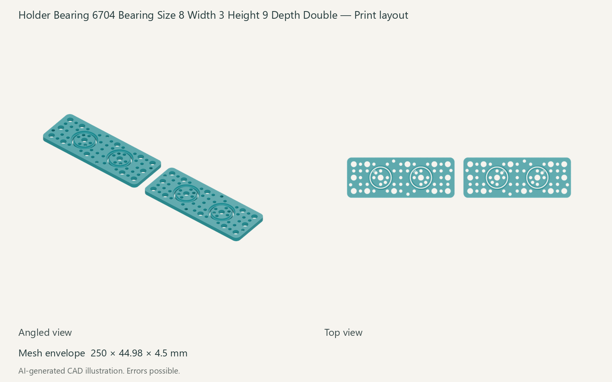
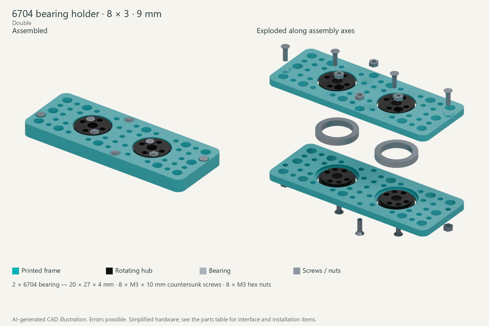

<!-- oobb-presentation:start -->
# Oobb Part Holder Bearing 6704 Bearing Size 8 Width 3 Height 9 Depth Double

AI-generated images and instructions. Errors possible.

## Summary

Parametric bearing holders with bearing-size, holder-style and mounting variants.

This is an entirely AI-generated coding project. The generated outputs are included and usually work, but the main purpose of publishing it is to give others a starting point for modifying the project with their own AI tools.



## Details

**Full OOMP ID:** `oobb_part_holder_bearing_6704_bearing_size_8_width_3_height_9_depth_double`

[Part folder](./) · [OOBB navigation](../../navigation_oobb/)

| Field | Value |
| --- | --- |
| Bearing Size | 6704 |
| Body | plate |
| Depth | 9 |
| Extra | double |
| Height | 3 |
| Holder Type | holder |
| Horn Adapter |  |
| Inner Joining Rotation | 45 |
| Interior Radius Name | m3 |
| Mounting Minimum Web | 0.3 |
| Oobb Name | bearing_holder |
| Prepare Print | True |
| Print Gap | 10 |
| Shaft | m6 |
| Split | True |
| Split Z | 0 |
| Width | 8 |
| Taxonomy | oobb / part / holder / bearing / 6704_bearing_size / 8_width / 3_height / 9_depth / double |

<details>
<summary>Full part details: all working.yaml fields</summary>

```yaml
bearing_positions:
- - 3
  - 2
- - 6
  - 2
bearing_size: '6704'
bip_39_2_word_array:
- apart
- evidence
bip_39_2_word_no_space: apartevidence
bip_39_2_word_space: apart evidence
bip_39_2_word_underscore: apart_evidence
bip_39_3_word_array:
- apart
- evidence
- drum
bip_39_3_word_no_space: apartevidencedrum
bip_39_3_word_space: apart evidence drum
bip_39_3_word_underscore: apart_evidence_drum
bip_39_full_array:
- apart
- evidence
- drum
- indoor
- mixture
- fabric
- best
- clerk
- share
- drill
- select
- speak
bip_39_full_no_space: apartevidencedrumindoormixturefabricbestclerksharedrillselectspeak
bip_39_full_space: apart evidence drum indoor mixture fabric best clerk share drill
  select speak
bip_39_full_underscore: apart_evidence_drum_indoor_mixture_fabric_best_clerk_share_drill_select_speak
depth: 9
directory: parts/oobb_part_holder_bearing_6704_bearing_size_8_width_3_height_9_depth_double
extra: double
height: 3
id: oobb_part_holder_bearing_6704_bearing_size_8_width_3_height_9_depth_double
id_no_class: oobb_part_holder_bearing_6704_bearing_size_8_width_3_height_9_depth_double
id_no_size: oobb_part_holder_bearing_6704_bearing_size_8_width_3_height_9_depth_double
id_no_type: oobb_part_holder_bearing_6704_bearing_size_8_width_3_height_9_depth_double
id_oobb: oobb_part_holder_bearing_6704_bearing_size_8_width_3_height_9_depth_double
inner_joining_rotation: 45
kwargs:
  bearing_positions:
  - - 3
    - 2
  - - 6
    - 2
  bearing_size: '6704'
  body: plate
  depth: 9
  extra: double
  filter: ''
  generate_stl: false
  height: 3
  holder_type: holder
  horn_adapter: ''
  inner_joining_rotation: 45
  interior_hole_positions: []
  interior_radius_name: m3
  modes:
  - 3dpr
  - 'true'
  mounting_minimum_web: 0.3
  navigation: false
  oobb_name: bearing_holder
  oomp_description_extra: m6_shaft_double_extra_9_depth
  oomp_description_main: bearing_holder_8_width_3_height
  oomp_mode: project
  oomp_run: false
  overwrite: true
  prepare_print: true
  print_gap: 10
  shaft: m6
  split: true
  split_z: 0
  typ: fast
  type: default_bearing_holder
  width: 8
link_github: https://github.com/oomlout/oomlout_oomp_version_1_messy/tree/main/parts/oobb_part_holder_bearing_6704_bearing_size_8_width_3_height_9_depth_double
link_main: https://github.com/oomlout/oomlout_oomp_version_1_messy/tree/main/parts/oobb_part_holder_bearing_6704_bearing_size_8_width_3_height_9_depth_double
link_redirect: https://github.com/oomlout/oomlout_oomp_version_1_messy/tree/main/parts/oobb_part_holder_bearing_6704_bearing_size_8_width_3_height_9_depth_double
md5: 0a49b90e3988e4a2c55153c5285f0d68
md5_10: 0a49b90e39
md5_10_upper: 0A49B90E39
md5_5: 0a49b
md5_5_upper: 0A49B
md5_6: 0a49b9
md5_6_alpha: eg8p
md5_6_alpha_upper: EG8P
md5_6_upper: 0A49B9
name: Oobb Part Holder Bearing 6704 Bearing Size 8 Width 3 Height 9 Depth Double
name_no_class: Oobb Part Holder Bearing 6704 Bearing Size 8 Width 3 Height 9 Depth
  Double
name_no_size: Oobb Part Holder Bearing 6704 Bearing Size 8 Width 3 Height 9 Depth
  Double
name_no_type: Oobb Part Holder Bearing 6704 Bearing Size 8 Width 3 Height 9 Depth
  Double
name_proper: Oobb Part Holder Bearing 6704 Bearing Size 8 Width 3 Height 9 Depth Double
name_space: oobb part holder bearing 6704 bearing size 8 width 3 height 9 depth double
name_upper: OOBB PART HOLDER BEARING 6704 BEARING SIZE 8 WIDTH 3 HEIGHT 9 DEPTH DOUBLE
oobb_details:
  bearing_positions:
  - - 3
    - 2
  - - 6
    - 2
  bearing_size: '6704'
  body: plate
  depth: 9
  extra: double
  height: 3
  holder_type: holder
  horn_adapter: ''
  inner_joining_rotation: 45
  interior_hole_positions: []
  interior_radius_name: m3
  mounting_minimum_web: 0.3
  oobb_name: bearing_holder
  prepare_print: true
  print_gap: 10
  shaft: m6
  split: true
  split_z: 0
  width: 8
oobb_name: bearing_holder
oomlout_ai_roboclick_1:
  actions:
  - command: text_jinja_template
    convert_to_pdf: false
    convert_to_png: false
    dict_data:
      bearing_positions:
      - - 3
        - 2
      - - 6
        - 2
      bearing_size: '6704'
      depth: 9
      directory: parts\oobb_part_holder_bearing_6704_bearing_size_8_width_3_height_9_depth_double
      extra: double
      height: 3
      id: oobb_part_holder_bearing_6704_bearing_size_8_width_3_height_9_depth_double
      inner_joining_rotation: 45
      name: oobb_part_holder_bearing_6704_bearing_size_8_width_3_height_9_depth_double
      name_proper: Oobb Part Holder Bearing 6704 Bearing Size 8 Width 3 Height 9 Depth
        Double
      name_space: oobb part holder bearing 6704 bearing size 8 width 3 height 9 depth
        double
      name_upper: OOBB PART HOLDER BEARING 6704 BEARING SIZE 8 WIDTH 3 HEIGHT 9 DEPTH
        DOUBLE
      oobb_details:
        bearing_positions:
        - - 3
          - 2
        - - 6
          - 2
        bearing_size: '6704'
        body: plate
        depth: 9
        extra: double
        height: 3
        holder_type: holder
        horn_adapter: ''
        inner_joining_rotation: 45
        interior_hole_positions: []
        interior_radius_name: m3
        mounting_minimum_web: 0.3
        oobb_name: bearing_holder
        prepare_print: true
        print_gap: 10
        shaft: m6
        split: true
        split_z: 0
        width: 8
      taxonomy_1: oobb
      taxonomy_10: ''
      taxonomy_11: ''
      taxonomy_12: ''
      taxonomy_13: ''
      taxonomy_14: ''
      taxonomy_15: ''
      taxonomy_2: part
      taxonomy_3: holder
      taxonomy_4: bearing
      taxonomy_5: 6704_bearing_size
      taxonomy_6: 8_width
      taxonomy_7: 3_height
      taxonomy_8: 9_depth
      taxonomy_9: double
      url_chat: ''
      width: 8
    dict_data_files: {}
    dict_data_files_exists: {}
    file_output: label_oomp.svg
    file_template: C:\gh\oomlout_oobb_part_holder_bearing_version_5\source_file\template_jinja\template_jinja_label_oomlout_76_2_mm_50_8_mm\working.svg.j2
    search_and_replace: []
  file_test: label_oomp.pdf
  retries_until_complete: 0
oomp_key: oomp_oobb_part_holder_bearing_6704_bearing_size_8_width_3_height_9_depth_double
project_name: C:\gh\oomlout_oobb_part_holder_bearing_version_5
taxonomy_1: oobb
taxonomy_10: ''
taxonomy_11: ''
taxonomy_12: ''
taxonomy_13: ''
taxonomy_14: ''
taxonomy_15: ''
taxonomy_1_capital: Oobb
taxonomy_1_first_letter: o
taxonomy_1_first_letter_upper: O
taxonomy_1_length_1: o
taxonomy_1_length_2: oo
taxonomy_1_length_3: oob
taxonomy_1_length_4: oobb
taxonomy_1_length_5: oobb
taxonomy_1_upper: OOBB
taxonomy_1_upper_length_1: O
taxonomy_1_upper_length_2: OO
taxonomy_1_upper_length_3: OOB
taxonomy_1_upper_length_4: OOBB
taxonomy_1_upper_length_5: OOBB
taxonomy_2: part
taxonomy_2_capital: Part
taxonomy_2_first_letter: p
taxonomy_2_first_letter_upper: P
taxonomy_2_length_1: p
taxonomy_2_length_2: pa
taxonomy_2_length_3: par
taxonomy_2_length_4: part
taxonomy_2_length_5: part
taxonomy_2_upper: PART
taxonomy_2_upper_length_1: P
taxonomy_2_upper_length_2: PA
taxonomy_2_upper_length_3: PAR
taxonomy_2_upper_length_4: PART
taxonomy_2_upper_length_5: PART
taxonomy_3: holder
taxonomy_3_capital: Holder
taxonomy_3_first_letter: h
taxonomy_3_first_letter_upper: H
taxonomy_3_length_1: h
taxonomy_3_length_2: ho
taxonomy_3_length_3: hol
taxonomy_3_length_4: hold
taxonomy_3_length_5: holde
taxonomy_3_upper: HOLDER
taxonomy_3_upper_length_1: H
taxonomy_3_upper_length_2: HO
taxonomy_3_upper_length_3: HOL
taxonomy_3_upper_length_4: HOLD
taxonomy_3_upper_length_5: HOLDE
taxonomy_4: bearing
taxonomy_4_capital: Bearing
taxonomy_4_first_letter: b
taxonomy_4_first_letter_upper: B
taxonomy_4_length_1: b
taxonomy_4_length_2: be
taxonomy_4_length_3: bea
taxonomy_4_length_4: bear
taxonomy_4_length_5: beari
taxonomy_4_upper: BEARING
taxonomy_4_upper_length_1: B
taxonomy_4_upper_length_2: BE
taxonomy_4_upper_length_3: BEA
taxonomy_4_upper_length_4: BEAR
taxonomy_4_upper_length_5: BEARI
taxonomy_5: 6704_bearing_size
taxonomy_5_capital: 6704 Bearing Size
taxonomy_5_first_letter: '6'
taxonomy_5_first_letter_upper: '6'
taxonomy_5_length_1: '6'
taxonomy_5_length_2: '67'
taxonomy_5_length_3: '670'
taxonomy_5_length_4: '6704'
taxonomy_5_length_5: '6704_'
taxonomy_5_upper: 6704_BEARING_SIZE
taxonomy_5_upper_length_1: '6'
taxonomy_5_upper_length_2: '67'
taxonomy_5_upper_length_3: '670'
taxonomy_5_upper_length_4: '6704'
taxonomy_5_upper_length_5: '6704_'
taxonomy_6: 8_width
taxonomy_6_capital: 8 Width
taxonomy_6_first_letter: '8'
taxonomy_6_first_letter_upper: '8'
taxonomy_6_length_1: '8'
taxonomy_6_length_2: '8_'
taxonomy_6_length_3: 8_w
taxonomy_6_length_4: 8_wi
taxonomy_6_length_5: 8_wid
taxonomy_6_upper: 8_WIDTH
taxonomy_6_upper_length_1: '8'
taxonomy_6_upper_length_2: '8_'
taxonomy_6_upper_length_3: 8_W
taxonomy_6_upper_length_4: 8_WI
taxonomy_6_upper_length_5: 8_WID
taxonomy_7: 3_height
taxonomy_7_capital: 3 Height
taxonomy_7_first_letter: '3'
taxonomy_7_first_letter_upper: '3'
taxonomy_7_length_1: '3'
taxonomy_7_length_2: '3_'
taxonomy_7_length_3: 3_h
taxonomy_7_length_4: 3_he
taxonomy_7_length_5: 3_hei
taxonomy_7_upper: 3_HEIGHT
taxonomy_7_upper_length_1: '3'
taxonomy_7_upper_length_2: '3_'
taxonomy_7_upper_length_3: 3_H
taxonomy_7_upper_length_4: 3_HE
taxonomy_7_upper_length_5: 3_HEI
taxonomy_8: 9_depth
taxonomy_8_capital: 9 Depth
taxonomy_8_first_letter: '9'
taxonomy_8_first_letter_upper: '9'
taxonomy_8_length_1: '9'
taxonomy_8_length_2: '9_'
taxonomy_8_length_3: 9_d
taxonomy_8_length_4: 9_de
taxonomy_8_length_5: 9_dep
taxonomy_8_upper: 9_DEPTH
taxonomy_8_upper_length_1: '9'
taxonomy_8_upper_length_2: '9_'
taxonomy_8_upper_length_3: 9_D
taxonomy_8_upper_length_4: 9_DE
taxonomy_8_upper_length_5: 9_DEP
taxonomy_9: double
taxonomy_9_capital: Double
taxonomy_9_first_letter: d
taxonomy_9_first_letter_upper: D
taxonomy_9_length_1: d
taxonomy_9_length_2: do
taxonomy_9_length_3: dou
taxonomy_9_length_4: doub
taxonomy_9_length_5: doubl
taxonomy_9_upper: DOUBLE
taxonomy_9_upper_length_1: D
taxonomy_9_upper_length_2: DO
taxonomy_9_upper_length_3: DOU
taxonomy_9_upper_length_4: DOUB
taxonomy_9_upper_length_5: DOUBL
url_chat: ''
width: 8
```

</details>

## Parts

Quantities for one complete printed holder/adapter, plus its listed interface. Installation fasteners are application-specific.

| Part | Quantity | Type | Use |
| --- | ---: | --- | --- |
| Printed frame halves | 2 | Print | Print all frame pieces in 3dpr.stl once |
| Printed hub pieces | 4 | Print | Print all hub pieces in 3dpr.stl once; preserve complementary faces |
| 6704 bearing — 20 × 27 × 4 mm | 2 | Hardware | Bore × outside diameter × width |
| M3 × 10 mm countersunk screws | 8 | Hardware | Join printed halves; follow the alternating head/nut faces |
| M3 hex nuts | 8 | Hardware | Opposite-face joining pockets |

[Machine-readable parts list](assembly.json) · [CSV parts list](assembly_parts.csv)

## Assembly




1. Print one complete 3dpr.stl layout. Keep the complementary frame and hub pieces in their matching orientation.

2. Load any captive nuts, coupler nuts or inserts while their pockets are accessible. Seat each bearing between its matching hub and frame pieces.

3. Close the complementary pieces and fit the listed joining screws and nuts, following the alternating head and nut recesses.

4. Fit the specified shaft or motor interface. Check free rotation before fastening the holder to the surrounding structure.


Joining screw length is a nominal stock selection; check protrusion against the recessed head and nut stack before tightening.

Bearing rings and fasteners are simplified nominal illustrations; threads, drive sockets, inserts and motor/interface hardware are omitted. Installation bolts depend on the surrounding assembly.


[Variant assembly notes](../../PROJECT_GUIDE.md)
<!-- oobb-presentation:end -->
